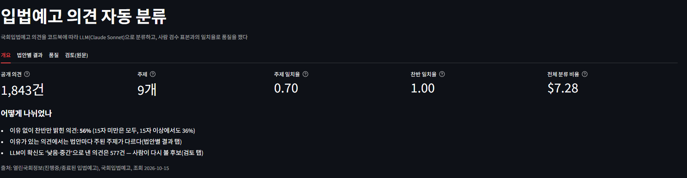
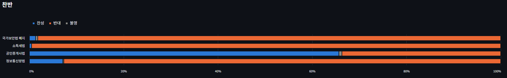
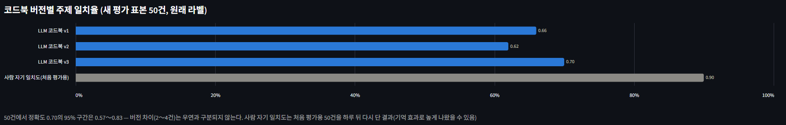
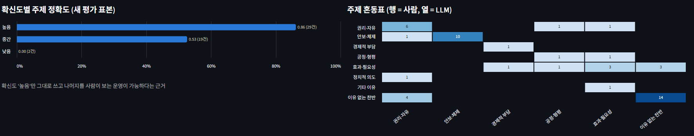

# 입법예고 의견 자동 분류

**시민이 국회에 남긴 법안 의견 1,843건을 LLM으로 자동 분류하고, 사람이 직접 분류한 결과와 얼마나 같은지로 품질을 잰 프로젝트입니다.**

설문조사의 주관식 응답처럼 자유롭게 쓴 글을 정해진 기준(코드북)에 따라 몇 가지 범주로 나누는 일을 리서치 실무에서는 "자유응답 코딩"이라고 부릅니다. 사람이 하면 시간이 많이 들고, LLM에 맡기면 빠르지만 결과를 그대로 믿을 수 없습니다. 이 프로젝트는 LLM에 코딩을 맡기고, **사람 검수 표본으로 품질을 숫자로 확인하는 절차**까지 끝까지 해 본 결과입니다.

## 한눈에

| 항목 | 결과 |
|---|---|
| 데이터 | 국회입법예고 4개 법안의 공개 의견 **1,843건** |
| 분류 기준 | 찬반(찬성·반대·불명) + 의견의 이유 **9개 주제** |
| 찬반 정확도 | **100%** — 사람 라벨과 비교, 평가 표본 두 개 모두 50건 중 50건 |
| 주제 정확도 | **70%**(Cohen's κ 0.61) — 분류 기준을 만드는 데 쓰지 않은 새 표본 50건 |
| 비교 기준 | 같은 사람이 같은 50건을 하루 뒤 다시 분류하면 **90%** 일치 |
| 비용 | 전체 분류에 API 정가 기준 **$7.28** |

출처: 열린국회정보(진행중/종료된 입법예고), 국회입법예고, 조회 2026-10-15

## 무엇을 알게 되었나

1. **찬반은 자동화할 수 있고, 주제는 사람 검토와 함께 써야 한다.** 찬반은 모두 맞았고, 주제는 10건 중 7건이 사람과 같았다. 사람도 자기 자신과 10건 중 9건만 같았다
2. **LLM이 "확신한다"고 한 의견은 믿을 만하다.** 확신도 '높음'인 의견은 사람과 86～100% 같았다. 확신도 '높음'만 그대로 쓰고 나머지 절반 정도만 사람이 보는 방식으로 검토량을 줄일 수 있다
3. **어긋난 의견을 다시 읽어 보면 사람 쪽이 흔들린 경우가 많았다.** 비슷한 의견에 사람은 때마다 다른 주제를 붙였고, LLM은 분류 기준 문장을 더 일관되게 따랐다
4. **이유를 밝히지 않은 의견이 절반을 넘는다.** 공개 의견의 56%가 "반대합니다"처럼 찬반만 밝혔다. 이유가 있는 의견에서는 법안마다 주된 이유가 달랐다



## 분류 기준 (코드북)

의견 하나에 **찬반** 하나와 **주제** 하나를 붙입니다. 주제는 4개 법안에 공통으로 쓰고, 찬성·반대 방향은 찬반 칸에 따로 둡니다. 전체 기준과 지어낸 예시는 [코드북](docs/코드북.md)에 있습니다.

| 주제 | 무엇을 이유로 드는가 |
|---|---|
| 권리·자유 | 국가가 국민의 기본권·자유를 줄인다(또는 되찾게 한다) |
| 안보·체제 | 북한·외부 세력 때문에 나라의 안보·체제가 위태롭다(또는 지켜진다) |
| 경제적 부담 | 세금·비용이 늘어 생활이 어려워진다 |
| 공정·형평 | 특정 집단을 차별하거나 특혜를 준다, 믿어 온 제도를 갑자기 바꾼다 |
| 효과·필요성 | 법이 필요한가, 목적을 이루나, 어떤 결과를 낳나 |
| 정치적 의도 | 내용 대신 발의자·정당의 의도를 문제 삼는다 |
| 기타 이유 | 이유는 있지만 위에 맞지 않는다 |
| 이유 없는 찬반 | 찬성·반대만 밝히고 이유가 없다 |
| 판단 불가 | 무슨 말인지, 이 법안에 대한 말인지 알 수 없다 |

## 결과

### 법안별 주제


이유가 있는 의견만 보면 국가보안법 폐지안은 안보·체제(84%), 정보통신망법은 권리·자유(78%), 소득세법은 공정·형평(40%)과 권리·자유(30%), 공인중개사법은 효과·필요성(46%)과 공정·형평(45%)이 많았다. 결과는 "의견이 어떤 주제로 나뉘는가"까지이며 특정 법안·정당을 평가하지 않는다.

### 법안별 찬반



공인중개사법만 찬성이 많았고(66%) 나머지 세 법안은 반대가 대부분이었다. 입법예고에 의견을 남긴 사람은 국민 전체를 대표하지 않는다.

## 품질을 어떻게 쟀나

LLM 결과를 그대로 쓰지 않고, **사람이 직접 분류한 표본과 비교**했습니다. 사람 라벨은 저장소 작성자가 모두 직접 달았습니다.


- **고치는 표본과 평가하는 표본을 나눴다.** 분류 기준을 고칠 때 본 의견으로 평가하면 점수가 부풀려진다. 그래서 기준을 고칠 때마다 아직 보지 않은 표본으로 다시 쟀다
- **같은 문안을 한 번만 셌다.** 같은 글을 몇 글자만 바꿔 여러 명이 낸 경우가 많았다. 글자 조각이 60% 이상 겹치면 같은 문안으로 묶고, 묶음마다 1건만 표본에 넣었다
- **사람 자신과의 일치도를 기준선으로 썼다.** 같은 50건을 하루 뒤 LLM 결과를 보지 않고 다시 분류하니 90%가 같았다. LLM의 70～80%는 이 기준선과 비교해 읽어야 한다



분류 기준을 v1 → v3로 고쳤지만, 50건 표본에서 2～4건 차이는 우연과 구분되지 않았다(95% 구간 0.57～0.83).



<details>
<summary>지표 풀이</summary>

- **정확도**: 사람과 LLM이 같은 주제를 붙인 비율
- **Cohen's κ(카파)**: 우연히 맞을 확률을 뺀 일치도. 0이면 우연 수준, 1이면 완전 일치. 0.61～0.80을 보통 "상당한 일치"로 본다
- **혼동표**: 행은 사람, 열은 LLM. 대각선이 맞은 것, 나머지가 어떤 주제끼리 헷갈렸는지
- **확신도**: LLM이 의견마다 스스로 매긴 높음·중간·낮음
- **95% 구간**: 표본이 50건이라 같은 방식으로 다시 뽑으면 정확도가 이 범위에서 움직일 수 있다
</details>

## 한계

- 평가 표본이 50건씩이라 정확도의 오차 범위가 넓다(±13%p 정도)
- 사람 라벨을 한 사람이 달았다. 다른 사람과의 일치도는 재지 못했고, 하루 뒤 다시 단 결과는 기억 때문에 높게 나왔을 수 있다
- 같은 기준으로 LLM을 여러 번 돌렸을 때의 흔들림은 재지 않았다
- 의견을 남긴 사람은 국민 전체를 대표하지 않는다. 법안당 의견 500건만 무작위로 받았다

자세한 수치와 과정은 [보고서](outputs/report.md)에 있습니다.

## 어떻게 만들었나

| 단계 | 한 일 | 결정 기록 |
|---|---|---|
| 수집 | 열린국회정보 Open API로 법안 목록 20,274건 → 소관 위원회가 다른 4개 법안 → 국회입법예고에서 의견 본문 2,000건(작성자 정보는 받지 않음, 요청 간격 1초) | [1015_01](docs/의사결정/1015_01_법안_선택과_표본.md) |
| 정제 | 제목+본문. 15자 미만 573건("반대합니다" 등)은 규칙으로, 15자 이상 1,270건은 LLM으로 | [1015_02](docs/의사결정/1015_02_짧은_의견_기준.md) |
| 분류 기준 | 의견 100건을 읽고 v1, 어긋난 사례를 보고 v2·v3 | [1015_03](docs/의사결정/1015_03_코드북_v1.md), [1017_01](docs/의사결정/1017_01_코드북_v2.md), [1017_02](docs/의사결정/1017_02_코드북_v3와_새_평가_표본.md) |
| 검수 표본 | 같은 문안 묶기, 개선용·평가용 나누기, 라벨 화면으로 사람이 직접 분류 | [1015_04](docs/의사결정/1015_04_검수_표본과_같은_문안.md) |
| 모델 | 개선용 50건으로 Claude Haiku·Sonnet 비교 → Sonnet | [1016_01](docs/의사결정/1016_01_분류_모델.md) |
| 전체 분류 | 코드북 v3로 분류 → SQLite → Streamlit 대시보드 | `src/build_db.py`, `src/dashboard.py` |

**LLM 호출**: 코드북을 그대로 지시문에 넣고, 의견마다 찬반·주제·근거 구절·확신도를 JSON 형식으로 받는다(형식은 스키마로 강제). Claude Code 명령줄(`claude -p`)을 작성자의 구독 안에서 써서 실제 청구는 없었고, 비용은 API 정가 환산액이다(`outputs/llm_runs.csv`).

## 저장소 구조

```
src/            수집·정제·표본·분류·일치율·DB·대시보드 코드
docs/
  코드북.md      분류 기준(현재 v3), 코드북_버전/에 v1·v2·v3
  의사결정/      단계마다 선택지·결정·근거·결과
  작업일지/      날짜별로 한 일
  AI_활용_기록.md AI가 한 것 / 작성자가 정한 것 / AI가 틀린 것
outputs/        집계·일치율·비용 기록(원문 없음), report.md
data/           원문·라벨·DB (저장소에 올리지 않음)
```

## 실행

Python 3.14, 로그인된 Claude Code 명령줄, 열린국회정보 인증키가 필요합니다.

```
python -m venv .venv
.venv\Scripts\pip install -r requirements.txt
copy .env.example .env          # ASSEMBLY_API_KEY를 채운다

.venv\Scripts\python src\collect_bills.py        # 법안 목록
.venv\Scripts\python src\collect_opinions.py     # 의견 본문(4개 법안 × 500건)
.venv\Scripts\python src\clean.py                # 정제·15자 기준
.venv\Scripts\python src\review_sample.py        # 검수 표본 → 라벨 시트
.venv\Scripts\streamlit run src\label_app.py     # 사람 라벨
.venv\Scripts\python src\classify.py --model sonnet --sheet all   # 전체 분류
.venv\Scripts\python src\agreement.py --model sonnet --codebook v3 --split eval2
.venv\Scripts\python src\build_db.py             # SQLite·집계
.venv\Scripts\streamlit run src\dashboard.py     # 대시보드
```

## 데이터와 개인정보

- 열린국회정보 이용약관·Open API 이용약관을 따랐다. 의견 작성자 이름·아이디는 처음부터 받지 않았고, 본문 속 전화번호·이메일·주민번호 패턴은 저장 전에 지웠다(검사 결과 0건)
- **의견 원문은 작성자의 저작물이라 저장소에 올리지 않았다.** 공개한 것은 건수·비율·일치율뿐이며, 문서의 예시는 모두 지어낸 문장이다. 대시보드도 원문이 보이는 검토 탭은 캡처하지 않았다

## AI와 함께 일한 방식

코드와 분석은 Claude Code와 함께 했고, 판단은 작성자가 했다. 단계마다 AI가 한 것 / 작성자가 정한 것 / AI가 틀린 것과 잡은 방법을 [AI 활용 기록](docs/AI_활용_기록.md)에 남겼다.

- 작성자가 정한 것: 데이터·법안 선택, 짧은 의견 기준, 분류 기준의 구조와 규칙, 같은 문안 처리, 모든 사람 라벨, 모델 선택, 다시 달기·새 평가 표본
- AI가 틀려서 고친 예: 코드북 v2에 넣은 규칙이 v1 규칙과 부딪힌 것을 놓쳤고, 사람이 다시 분류한 결과에서 발견해 v3에서 고쳤다
